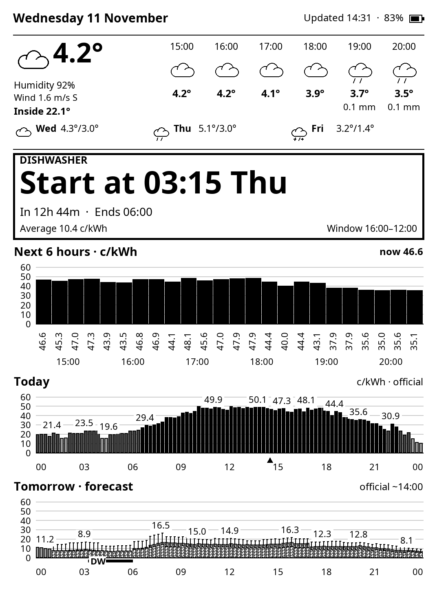

# Kindle dashboard for Home Assistant

Turn an old, jailbroken Kindle into a low-power e-ink dashboard for Home Assistant.

- **`custom_components/kindle_dash`** — a Home Assistant integration that draws a 1072×1448 grayscale PNG (weather, electricity prices for the next 6 hours / today / tomorrow, and when to run the dishwasher) and serves it to the Kindle. It also tells the Kindle how long to sleep, and exposes the Kindle's battery and a "stopped checking in" problem sensor.
- **`kindle/`** — a KUAL extension for the Kindle (tested target: Paperwhite 3 / 7th gen). It wakes on an RTC alarm, turns wifi on only to fetch the image, displays it and suspends again.



## Requirements

- Home Assistant 2026.11 or newer.
- A jailbroken Kindle with KUAL (and SSH for installing/debugging).
- Entities for weather, 15-minute electricity prices (`data_today` / `data_tomorrow` lists of `{start, end, buy}`) and a [load-scheduler](https://github.com/machadolucas/ha-load-scheduler) schedule sensor for the dishwasher. All entity ids are configurable.

## Install the integration (HACS)

1. HACS → ⋮ → *Custom repositories* → add `https://github.com/machadolucas/kindle-ha-dash` as type *Integration*.
2. Install **Kindle dashboard**, restart Home Assistant.
3. *Settings → Devices & services → Add integration → Kindle dashboard*.
4. Open the integration's *Configure* dialog to pick entities, edit the schedule and copy the image URL path (it contains a secret token).

### Schedule

One period per line, `HH:MM-HH:MM <interval in minutes>`:

```
08:30-00:00 30
00:00-08:30 60
```

The Kindle is told to sleep until the next point on this grid, so changes take effect at its next check-in.

### Entities

| Entity | Meaning |
|---|---|
| Battery | Kindle battery level reported at each check-in |
| Charging | Whether the Kindle is charging |
| Last seen / Next expected | Check-in timestamps |
| Problem | On when the Kindle is overdue by more than the grace period (default 2 h) |

Example automation: notify when `binary_sensor.kindle_dashboard_problem` turns on or the battery sensor drops below 15 %.

## Install on the Kindle

See [kindle/README.md](kindle/README.md).

## Development

See [tools/README.md](tools/README.md) for tests and offline previews.

## License

MIT. Bundled Noto Sans fonts are under the SIL Open Font License.
